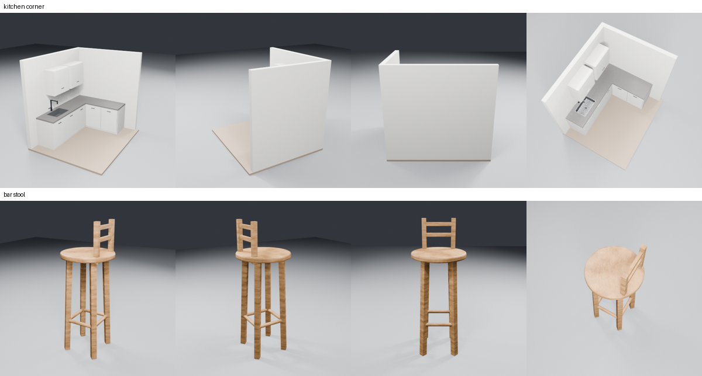
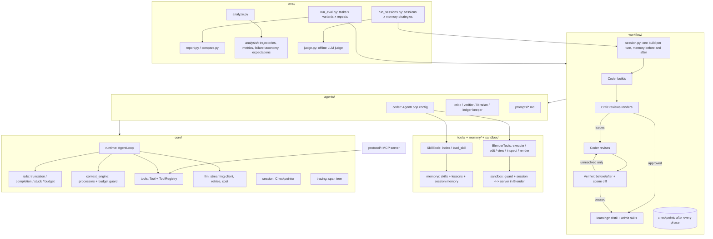
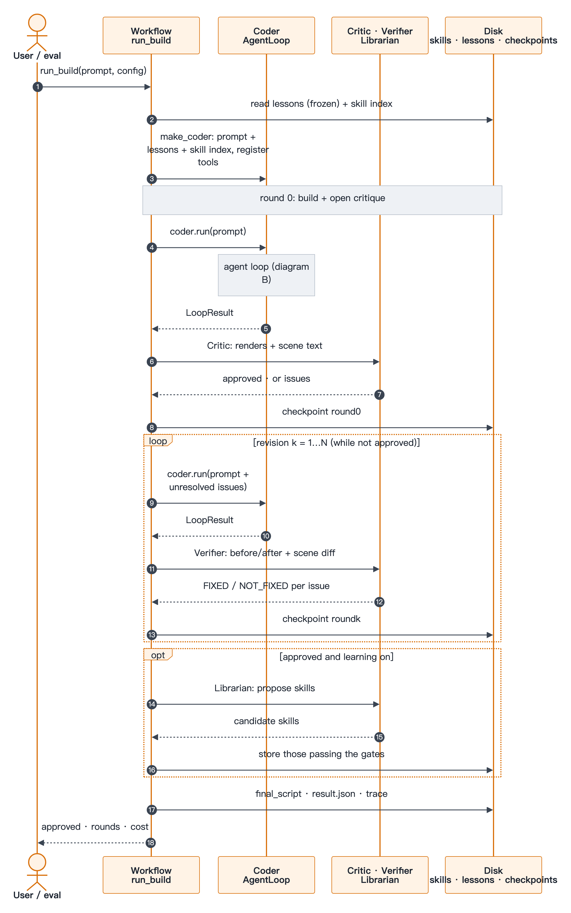
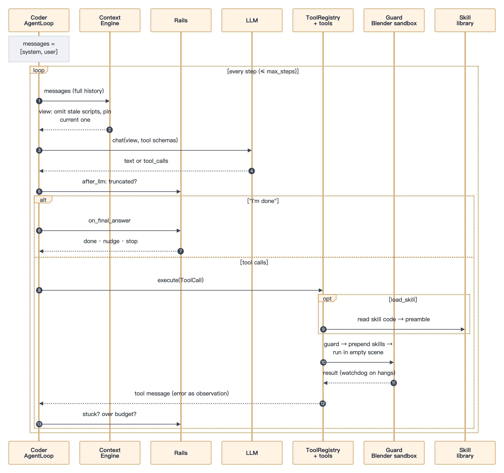
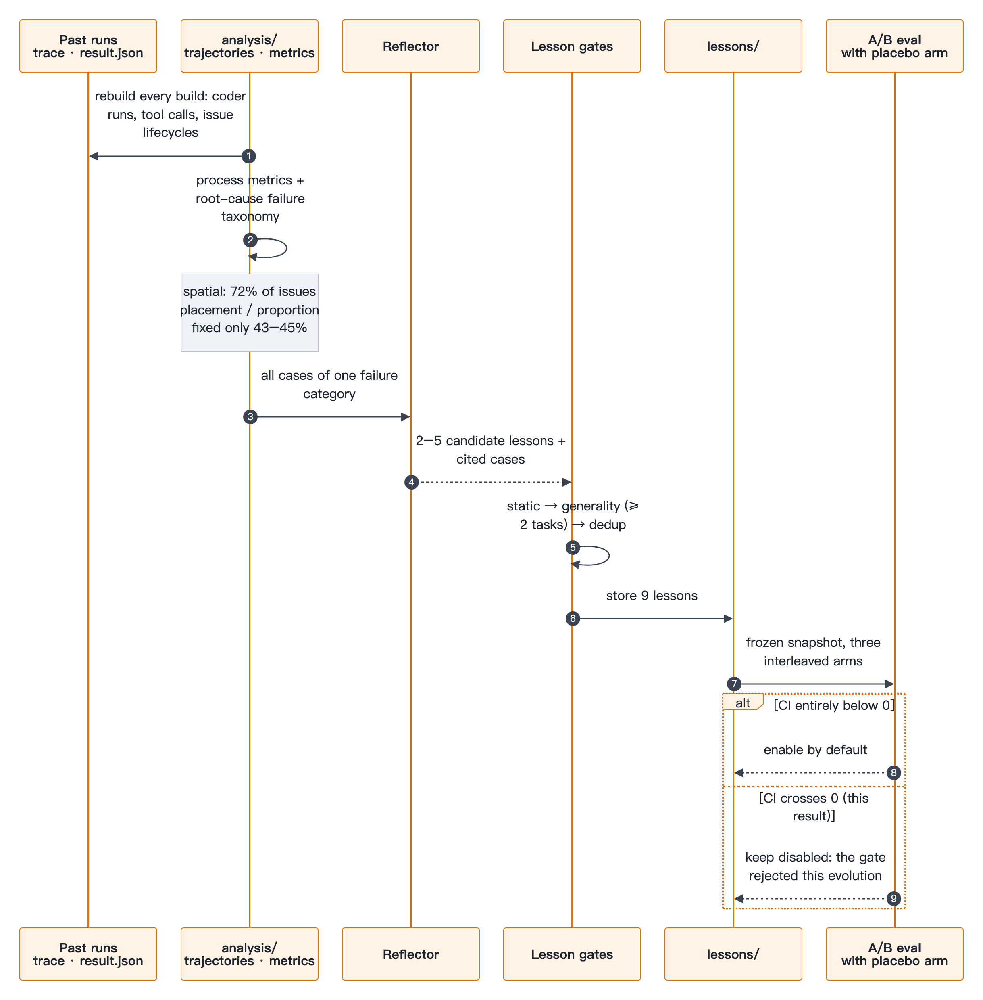
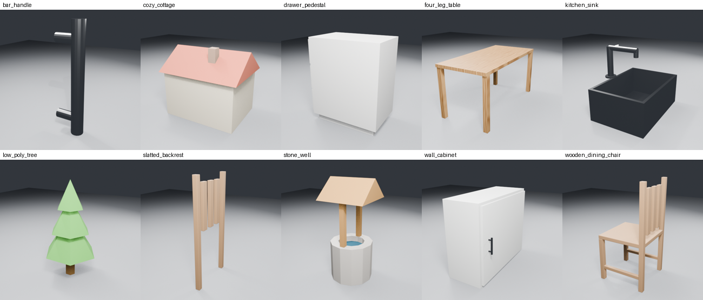

# BlendHarness

**A self-evolving multi-agent harness for Blender: it turns natural language into editable 3D scenes by writing Blender Python, on top of an agent harness built from scratch.**

[中文说明](README.zh-CN.md)



Instead of generating meshes directly, a **Coder** agent writes and runs `bpy` scripts in a sandboxed headless Blender, a vision **Critic** reviews the renders, and a **Verifier** checks every requested fix against before/after renders and a structural scene diff. Approved builds can be distilled into a **self-evolving skill library** of verified, reusable modeling functions. The output is a plain Python script, so every object stays editable. Scenes can also be edited over many turns: each user request edits the previous turn's script, with layered session memory and programmatic regression checks.

The original idea comes from the [LL3M paper](https://arxiv.org/abs/2508.08228). This repository contains no LL3M code: the harness, sandbox, agents, memory and evaluation were written from scratch and redesigned around measurements.

## Highlights

- **Own agent harness.** A tool-calling agent loop (the model decides, the harness executes) that keeps only mechanism. Policies live in pluggable **rails**: truncation handling, harness-verified completion, repeated-error stop and cost budget, consulted at fixed events by priority.
- **Process-isolated Blender sandbox with a static guard.** One long-lived headless Blender per task, a reset to an empty scene before every run, and a watchdog for hangs and crashes. Model code is checked with `ast` before it runs (no file system, process or network access). Calibrated on 232 past scripts, including a real run where the Coder walked the host disk to read its own logs.
- **Context engine.** A pipeline of processors builds what the model sees from the full history: stale scripts become placeholders, the current script is pinned, and a budget guard is the last line of defense. Token estimates are calibrated on our own traces (2.3 chars/token for code-heavy context, not 4).
- **Tools with permission tiers.** One `ToolRegistry` (read / write / execute) backs both the agent loop and an **MCP server**, so Claude Desktop, Claude Code or Cursor can use the same sandbox.
- **Checkpoints.** Every phase ends at a safe point with an atomic JSON checkpoint: resume an interrupted build, or fork a new one from any phase with another config.
- **Two-step visual review.** The **Critic** answers an open question ("what is wrong?") and the **Verifier** a closed one ("was each issue fixed, and did anything regress?"). Cheap programmatic checks always run before vision models.
- **Self-evolving skill library.** A librarian distills approved builds into reusable functions, admitted only through four gates (static, dedup, sandbox, structure plus vision) with one repair round. Skills are listed in the prompt and loaded on demand.
- **Tracing and evaluation.** Every LLM call, tool call and agent run is a span with tokens, cost and latency. A resumable, crash-isolated eval runner interleaves variants for fair comparison.
- **Trace-based evaluation and gated self-evolution.** Every past build is rebuilt from its trace into process metrics and a root-cause failure taxonomy. A Reflector turns failure cases into lessons (semantic memory), which are only adopted if a pre-registered A/B test on unseen tasks, with a placebo control, shows they help. So far they did not, and the gate kept them out (see Results).
- **Multi-turn scene editing.** A session feeds one request per turn; each turn is a full build that starts from the previous turn's script, and from turn 2 the Coder must declare what it changed. Three memory strategies are comparable from the same forked starting point: full request history (M0), structured memory (M2: an append-only requirement ledger kept by an LLM behind programmatic gates, plus a scene registry and turn log generated by code from real scene snapshots, in SQLite), and retrieval (M3: script sections retrieved with BM25 + local embeddings + RRF and def-use expansion).
- **Two-layer evaluation for multi-turn edits.** Programmatic checks on scene snapshots (did the requested change happen, did anything outside the allowed objects change, do earlier requirements still hold) and an offline LLM judge from a different model family (atomic rubric questions with dependencies, anchored scores, side-swapped pairwise comparison with Bradley–Terry Elo). A pilot calibrated the checks before reading any result.
- **Tested.** 286 tests in about 8 s: unit tests on a scripted fake LLM and fake Blender, layering rules, and integration tests on a real Blender.

## Architecture



| Layer | Folder (`blendharness/`) | Responsibility |
|---|---|---|
| Core | `core/` | Generic mechanism, nothing Blender-specific: `runtime` (agent loop), `rails`, `context_engine`, `tools` (Tool, ToolRegistry), `llm`, `session` (checkpoints), `tracing` |
| Sandbox | `sandbox/` | `server.py` runs **inside** Blender, `session.py` drives it with a watchdog, `guard.py` checks code statically |
| Memory | `memory/` | `skills/`: `SkillLibrary`, one folder per skill (`SKILL.md` + `skill.py` + `stats.json`); `lessons/`: `LessonLibrary`, rules learned from failures; `session/`: multi-turn memory in SQLite (requirement ledger, scene registry, turn log, vector cache), script sections and retrieval |
| Analysis | `analysis/` | Rebuild builds from `trace.jsonl` + `result.json` (coder runs, tool calls, the life of each issue across rounds), process metrics, root-cause failure taxonomy; structure and relation checks; `expectations.py`: multi-turn checks and regressions on scene snapshots |
| Tools | `tools/` | `BlenderTools` (script state, execute / edit / view / inspect), `scene.py`, `render.py`, `SkillTools` |
| Agents | `agents/` | Configurations: Coder (prompt + tools + context pipeline + completion check), Critic, Verifier, Librarian, Reflector, ledger keeper; prompts in `prompts/*.md` |
| Workflow | `workflow/` | `run_build`: build / critique / revise / verify / learn as checkpointed phases; `session.py`: multi-turn sessions (memory strategies, per-turn checkpoints, resume and fork); `learning/`: skill admission gates and learning loop, lesson gates |
| Protocol | `protocol/` | `blendharness-mcp`: the tools as an MCP server |

Layering is one-way (`core` ← `sandbox`, `memory` ← `tools` ← `agents` ← `workflow`; `analysis` uses only `core`; `protocol` uses `tools`) and enforced by `tests/unit/test_architecture.py`. See [`docs/architecture.md`](docs/architecture.md).

Design principles: **mechanism vs. policy** (the loop runs, rails decide), **framework vs. configuration** (one loop, agents are configs), **dependency inversion** (`BlenderTools` only knows a generic `preamble_provider`, not skills), **cheap before expensive** (deterministic checks before vision models), and **fail-safe** (critics and gates reject when in doubt).

## How one build runs

Two nested loops: an outer **workflow** written in code (build → critique → revise → verify → learn, with a checkpoint after every phase) and an inner **agent loop** in which the model decides each next step. Only the Coder runs in the agent loop; the Critic, Verifier and Librarian are single calls.

**A · Workflow (outer, decided by code)**



**B · Agent loop (inner, decided by the model)**: what happens inside every `coder.run(...)`



**C · Learning lessons from failures (offline, gated by evaluation)**



Diagram sources are in [`docs/diagrams/`](docs/diagrams/) (Mermaid); `python scripts/render_diagrams.py` re-renders them with headless Chrome. [`docs/blendharness_flow.html`](docs/blendharness_flow.html) has all four lifecycle diagrams in one page (one build, learning lessons, one multi-turn turn, the multi-turn experiment); open it locally in a browser.

## Multi-turn scene editing

Real users rarely describe a whole scene at once; they keep asking for changes. That adds two problems a single build does not have: **memory** (earlier requirements must not be forgotten, and "the bucket" must resolve to the right object) and **regressions** (one edit must not break the rest), and regressions can be checked by a program. Design, code walkthrough and results: [`docs/multiturn_design.md`](docs/multiturn_design.md).

How one turn runs (`workflow/session.py`):
1. The request arrives only after the previous turn has finished; the system never sees later turns or the evaluation's expected changes.
2. Memory is restored from the previous turn's copy, so redoing an interrupted turn cannot write a requirement twice.
3. (M2 / M3) A ledger keeper (one Haiku call) proposes new, superseded and referenced requirements; code checks the proposal (only active ids may be superseded, a reason is required, object names must exist), retries once with the problems listed, and otherwise appends the request verbatim. Code, not the model, writes the ledger.
4. The task text is built from the memory strategy: M0 lists earlier requests verbatim; M2 shows the active ledger, a code-generated scene registry and a one-line-per-turn log; M3 also replaces the pinned script with an outline plus the retrieved sections.
5. A normal `run_build` edits the previous script (Critic, revisions and Verifier unchanged); from turn 2 the Coder must call `declare_changes`.
6. Code computes unrequested changes (snapshot diff minus declarations) and the sections the edit really touched (the retrieval ground truth), rebuilds the registry from the new snapshot, and checkpoints the session state and memory side by side.

Evaluation: each session turn carries `expect` (checks on the scene snapshot), `touches` (objects the turn may change; anything else that changes is a regression), `persist` (requirements that must keep holding) and a rubric for the judge. `eval/run_sessions.py` runs turn 1 once per session and forks every arm from it, in parallel; `eval/judge.py` adds the LLM judge; `eval/replay_retrieval.py` replays retrieval offline on recorded sessions at zero model cost.

## Results

All numbers come from the eval harness. The first table was measured before the October 2026 restructuring (commit `6d3ed0c`), and each later section states its own setup; the restructuring kept behaviour identical, checked by unchanged tests, character-identical prompts and a differential test of the context policy. The coder is Claude Sonnet with `reasoning_effort: low`, and the critic, verifier and skill review use Claude Haiku. Each condition ran **twice**, so treat small differences as noise.

| Experiment | Setup | Finding |
|---|---|---|
| `m3_vs_baseline` | 6 tasks x 2 repeats, full rewrites + full history vs. edit tool + compaction (v1) | Same pass rate (75%) and −13% cost per task. **Revision rounds got more expensive** (median $0.446 vs $0.274): compaction hid the script being edited (17 re-reads), and many small edits meant many round trips. A single-run "−73%" did not replicate. |
| `m3v2` | Pinned current script + batched all-or-nothing edits, 3 hardest tasks x 2 | **6/6 passed** (baseline 4/6), **−14% cost per task**, 0 re-reads. 85–92% of revision output tokens are hidden thinking, so the remaining cost lever is reasoning control, not context. |
| `skills_lc` | Learning curve: train on 5 tasks, then test on 5 unseen tasks that share components, with vs. without the library | Library grew to 10 verified skills (the repair round rescued 8 rejected candidates; the 5 structural rejections among them later proved to be false alarms caused by a Scene-Inspector bug, see below). Test pass rate was 6/10 with skills vs 8/10 without, **but all 4 failures were unrelated to skills**. Only **4/10 runs adopted a skill**. Where skills were used (village), 2/2 passed in the first round at −34% cost. Bottleneck: coarse, whole-object skills transfer poorly. |

### Self-evolution from failures, gated by evaluation (October 2026)

| Step | Setup | Finding |
|---|---|---|
| Trajectory analysis | 69 past builds, 79 Critic issues labelled by root cause | Spatial problems are **72%** of all issues. Contact problems (floating, interpenetration) are fixed 73–85% of the time by the Critic → Coder → Verifier loop; **relational** ones (placement, proportion) only **43–45%**, and they are the largest share of problems left in failed builds. Code errors are not the bottleneck: 9% of executions fail and 89% recover within the same run. |
| Lessons | A Reflector reads the 23 relational cases (problem, suggested fix, verifier evidence) | 9 lessons, e.g. "derive a part's position from the bounding box of the part it rests on", "fix placement through location/rotation, not dimensions". Gates: generality (cited cases from ≥ 2 tasks, checked by us), dedup. |
| `lessons_ab` | 8 unseen tasks avoiding training objects, with vs. without lessons, x 2 | Pre-registered primary metric (relational issues in round 0): no result, **floor effect** (2 vs 1 such issues in 16 builds each). Exploratory: −24% cost, −20% coder steps. |
| `lessons_confirm` | Pre-registered confirmation: with / without / **placebo** (generic advice of the same length) x 2 | **The cost effect did not replicate** (with − without: −$0.007, 95% CI [−0.12, +0.11]). The control arm's cost moved 34% between nights, more than the effect being measured. The lessons are therefore **not enabled by default**: the evaluation gate rejected this evolution step. |

### Post-fix baseline (October 2026)

After fixing the Scene-Inspector bug (see below) and making `inspect_scene` report bounding boxes instead of object origins, 26 tasks were rerun with Sonnet (x2) and DeepSeek-v4-pro (x1), interleaved: 78 builds, $21.2. Sonnet's final pass rate was 92–100% with about 0.2–0.3 spatial issues per build in round 0; DeepSeek had 2–4x more issues (mostly materials and shapes) at 40–70% of the cost. A spatial-repair model would therefore have little room to improve this pipeline, which redirected the next steps to multi-turn editing and to post-training a small model.

### Multi-turn pilot (October 2026)

3 sessions (village, bedroom, street corner; 6 turns each) x M0 x2, M2 x2, M3 x1 = 75 editing turns, $48.6. This is an exploratory pilot: the programmatic checks were calibrated on its data (five checks that failed in every arm turned out to be wrong, e.g. `frame` also matched `Bed_Frame`; each fix is documented in the session file), so read the numbers as observations with diagnosed causes, not confirmed effects.

| Metric | M0 full history | M2 structured memory | M3 + retrieval |
|---|---|---|---|
| Turn completion (all checks pass) | 93% | 93% | 73% |
| Turns with a regression | 1/30 | 0/30 | 1/15 (133 objects) |
| Requirement retention | 100% | 100% | 100% |
| Cost per turn | $0.44 | $0.49 | $0.74 |

- **Structured memory showed no benefit in short sessions.** Six one-sentence requests are short enough to keep verbatim, retention was 100% everywhere, and the references were easy. The pairwise LLM judge (gpt-5.5, side-swapped) agreed: ties dominated five of six dimensions. The components themselves worked: 0 fallbacks in 45 ledger updates, and every sampled supersede was correct.
- **The retrieval view cost more than it saved at this script size** (about 5k tokens, below the 12k threshold in the design, but forced for the test). The Coder made 3.8 code reads per turn and twice rewrote the whole scene from memory, once causing 133 regressions.
- **Retrieval itself was fine but hybrid did not help.** Replayed offline on M2 turns: recall@3 was 0.76 for embeddings, 0.62 for BM25 and 0.60 for RRF hybrid.
- **A check that fails in every arm is usually the check.** Running a pilot before any formal experiment paid for itself.

Takeaways: an exploratory win needs a pre-registered confirmation and a placebo arm (the second time in this project a single-experiment effect failed to replicate); the test distribution must contain the failures being targeted (relational errors cluster in multi-object scenes, which motivates a dedicated spatial-layout project); and the API relay itself is an experimental variable (it silently blocked some prompts, and the blocking changed over time).

### Skill library

The skill library learned in `skills_lc` is in [`skills/`](skills/):



Lessons that shaped the design, each found through traces or evals:
- Checkers need checking too. The structural gate (grounded and connected) rejected 5 skill candidates as "sunk". A later geometry-only audit of all 144 builds showed these were false alarms: scripts that set `obj.location` / `obj.scale` without a depsgraph update left `matrix_world` stale, so the Scene-Inspector's world bounding boxes sat at the origin, unscaled (35% of builds had at least one such object). The Inspector now refreshes the view layer first, and all 5 candidates pass. The A/B results above are unaffected, since both arms of each comparison shared the bug.
- Reasoning models over-think. Default thinking used 12k–32k tokens before the first tool call. `reasoning_effort: low` cut it to about 1.7k, and the same flag *turns thinking on* for Haiku, so effort is set per agent.
- The relay closed some streams silently after two tokens. Streams without `finish_reason` are now treated as incomplete and retried.

## Getting started

**Requirements:** macOS or Linux, [Blender 4.4.3](https://download.blender.org/release/Blender4.4/), Python 3.12, and an OpenAI-compatible API (the experiments used a relay for Claude and the DeepSeek API).

```bash
conda create -n blender-agent python=3.12 -y && conda activate blender-agent
pip install -e ".[dev,mcp]"    # the blendharness package, pytest and the MCP SDK
cp .env.example .env        # fill in OPENAI_BASE_URL / OPENAI_API_KEY (and DEEPSEEK_* if used)
# Blender path defaults to /Applications/Blender.app/Contents/MacOS/Blender; override with BLENDER_PATH
```

Models are routed by name prefix: `deepseek*` goes to `DEEPSEEK_*`, `gpt*` / `gemini*` go to `JUDGE_*` (the offline judge, falling back to `OPENAI_*` if unset), and everything else goes to `OPENAI_*`. Retrieval (M3) needs `pip install -e ".[retrieval]"`; the local embedding model is downloaded once to `models/fastembed/`. Set prices in `config/prices.json` (USD per million tokens) so costs and budgets are computed.

```bash
python scripts/smoke_llm.py claude-haiku-4-5     # API, function calling, error tracing
python scripts/smoke_blender.py                  # sandbox: reset, errors, watchdog, render

# Build one scene (Coder -> Critic -> revise -> Verifier)
python scripts/run_build.py "Create a wooden dining chair with four legs and a slatted backrest" \
    --model claude-sonnet-4-6 --critic-model claude-haiku-4-5 --rounds 2 --effort low

# Resume an interrupted build, or fork a new one from a phase with another config
python scripts/run_build.py --resume runs/<run_id>
python scripts/run_build.py --fork-from runs/<run_id> --at round0 --rounds 3

# Evaluate
python eval/run_eval.py --exp my_exp --variants baseline m3 --repeats 2 --workers 3
python eval/report.py --exp my_exp
python eval/compare.py --exp my_exp --a baseline --b m3        # paired A/B with bootstrap CIs

# Trace analysis and self-evolution from failures
python eval/analyze.py                  # metrics + failure taxonomy over all past builds -> runs/analysis/
python scripts/reflect.py --dry-run     # the failure cases the Reflector would read
python scripts/reflect.py               # distil lessons into lessons/ (use with BuildConfig(lessons_dir=...))

# Multi-turn: an interactive session (--memory history / structured / retrieval; --resume DIR; --fork DIR TURN)
python scripts/run_session.py --memory structured

# Multi-turn experiment: turn 1 once per session, every arm forked from it, scored by programmatic checks
python eval/run_sessions.py --exp pilot --jobs 5
python eval/judge.py --exp pilot --model gpt-5.5 --modes rubric scores
python eval/judge.py --exp pilot --model gpt-5.5 --pairwise M2 M0
python eval/replay_retrieval.py runs/sessions/pilot/*/M2_r* --k 1 3 5

# Tests (no API calls; the integration tests are skipped without Blender)
python -m pytest

# Serve the tools to MCP clients (Claude Desktop, Claude Code, Cursor): see docs/mcp.md
blendharness-mcp
```

A multi-turn experiment writes `runs/sessions/<exp>/<session>/`: `base/` (turn 1), one folder per arm (`session.json`, `score.json`, `checkpoints/memory_tNN.db`, `turns/tNN/` with scene snapshots and judge verdicts) and `summary.md`.

Each run writes `runs/<run_id>/`, which contains `trace.jsonl` (span summaries), `payloads/` (full model requests and replies), `renders/`, `checkpoints/` (one JSON per finished phase), `final_script.py` (standalone, including skill code), `result.json` and `blender.log`.

## Repository layout

```
blendharness/
  core/        runtime/  rails/  context_engine/  tools/  llm/  session/  tracing/
  sandbox/     server.py  session.py  guard.py
  memory/      skills/library.py  lessons/library.py  session/{store,views,sections,retrieval}.py
  analysis/    trajectory.py  metrics.py  taxonomy.py  structure.py  relations.py  expectations.py
  tools/       blender_tools.py  scene.py  render.py  skill_tools.py
  agents/      coder.py  critic.py  verifier.py  librarian.py  reflector.py  ledger_keeper.py  prompts/*.md
  workflow/    build.py  state.py  session.py  learning/admission.py  learning/learn.py  learning/lessons.py
  protocol/    mcp_server.py
eval/          run_eval.py  report.py  compare.py  analyze.py  run_sessions.py  judge.py  judge_prompts/
               replay_retrieval.py  audit_structure.py  validate_relations.py  postfix_report.py
               tasks*.json  sessions_draft.json  placebo_lessons/
scripts/       run_build.py  run_session.py  walkthrough.py  render_diagrams.py  reflect.py  relearn.py  recost.py  smoke_*.py
tests/         unit/  integration/  fakes.py
skills/        learned skill library
lessons/       learned lessons (not enabled by default: they did not pass the A/B gate)
config/        prices.json
docs/          architecture.md  multiturn_design.md  agentic_rl_plan.md  blendharness_flow.html  sessions_draft.md
               mcp.md  roadmap.md  diagrams/ (Mermaid sources + PNG)  images
```

## Limitations and roadmap

- **Small samples.** There are two repeats per condition, and the variance between identical runs is large. Key experiments should be repeated 3–5 times.
- **Lessons not confirmed.** Neither the targeted relational errors nor the cost were measurably reduced on single-object test tasks; the targeted errors are rare there. A fair test needs multi-object scenes, where relational errors actually occur.
- **Skill adoption.** Skills are too coarse to transfer. Next: distil composable parts (leg sets, drawer stacks, handles, roofs) and have the harness retrieve and recommend the top-k skills per request.
- **Cost.** Most revision cost is hidden reasoning. Next: stage-based model routing (cheaper models or lower effort for revisions) and a failure-driven cascade, compared against all-cheap and all-strong.
- **Sandbox scope.** Process isolation plus a static guard catches the realistic cases, but static checks can be obfuscated around; a public service would need containers.
- **Rendering.** Colors are slightly washed out, and specular highlights on liquids can make vision models hallucinate objects.
- **Multi-turn pilot.** Three short sessions, one M3 run each, checks calibrated on the same data. Showing what memory is worth needs longer sessions (12+ turns) with references back to early turns and requirements that are overturned and restored. M3 needs fixes before a fair test: no whole-scene rewrites from the outline view, compaction of stale reads, and the outline only above the length threshold. The LLM judge and the Critic still need calibration against human labels.
- **Name-based checks.** Programmatic checks match object names, so odd names cause misjudgements, and a model could game them by renaming.
- **Next: post-training.** A plan to train a small model (Qwen3-1.7B, SFT then GRPO) as a scene editor, with rewards computed entirely by these checks (runs, requested change done, regression penalty): [`docs/agentic_rl_plan.md`](docs/agentic_rl_plan.md).

More design notes are in [`docs/roadmap.md`](docs/roadmap.md).
