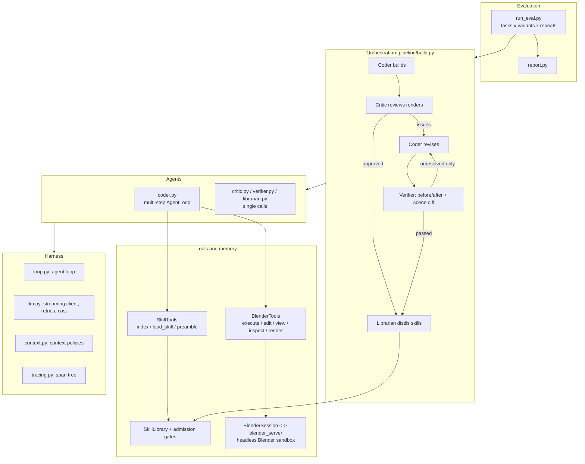

# blender-agent

**A multimodal multi-agent system that turns natural language into editable 3D scenes by writing Blender Python, built on a from-scratch agent harness.**

[中文说明](README.zh-CN.md)


Instead of generating meshes directly, a **Coder** agent writes and runs `bpy` scripts in a sandboxed headless Blender, a vision **Critic** reviews the renders, and a **Verifier** checks every requested fix against before/after renders and a structural scene diff. Approved builds can be distilled into a **self-evolving skill library** of verified, reusable modeling functions. The output is a plain Python script, so every object stays editable.

The original idea comes from the [LL3M paper](https://arxiv.org/abs/2508.08228). This repository contains no LL3M code: the harness, sandbox, agents, memory and evaluation were written from scratch and redesigned around measurements.

## Highlights

- **Own agent harness.** A tool-calling agent loop (the model decides, the harness executes) with error-as-observation, three budgets (steps, repeated errors, cost), truncation handling and harness-verified completion checks.
- **Process-isolated Blender sandbox.** One long-lived headless Blender per task, a reset to an empty scene before every run, and a watchdog that kills and restarts Blender on infinite loops or crashes.
- **Full tracing.** Every LLM call, tool call and agent run is a span in a tree, with tokens, cost, latency and errors. All the numbers below come from these traces.
- **Context management.** The agent sees a compacted view while the full history is kept. Stale scripts become placeholders, the current script is pinned at the end, and edits are batched and transactional.
- **Two-step visual review.** The **Critic** answers an open question ("what is wrong?") and the **Verifier** answers a closed one ("was each issue fixed, and did anything regress?"). Cheap programmatic checks always run before vision models.
- **Self-evolving skill library.** A librarian distills approved builds into reusable functions. Each candidate passes four admission gates (static, dedup, sandbox, structure plus vision) with one repair round. Skills are listed in the prompt and loaded on demand (progressive disclosure).
- **Evaluation harness.** Fixed task sets and a resumable, crash-isolated, parallel runner. Variants are interleaved for fair comparison, and reports read per-round costs from the traces.

## Architecture



| Layer | Folder | Responsibility |
|---|---|---|
| Harness | `harness/` | Mechanism shared by all agents: `AgentLoop`, `LLMClient` (streaming, retries, multi-provider, cost), span `Tracer`, context-policy building blocks |
| Tools | `tools/` | Sandbox (`blender_server.py` runs **inside** Blender, `blender_session.py` drives it), `BlenderTools`, `SkillTools` |
| Memory | `memory/` | `SkillLibrary` (one folder per skill: `SKILL.md` + `skill.py` + `stats.json`), admission gates, learning loop |
| Agents | `agents/` | Configurations: Coder (prompt + tools + context policy + completion check), Critic, Verifier, Librarian |
| Orchestration | `pipeline/` | `run_build(prompt, BuildConfig)`: the full build / critique / revise / verify / learn flow |
| Evaluation | `eval/` | Task sets, batch runner, reports |

Design principles: **mechanism vs. policy** (the harness provides hooks, agents choose strategies), **framework vs. configuration** (one generic loop, agents are just configs), **dependency inversion** (`BlenderTools` only knows a generic `preamble_provider`, not skills), **cheap before expensive** (deterministic checks before vision models), and **fail-safe** (critics and gates reject when in doubt).

## Results

All numbers come from the eval harness. The coder is Claude Sonnet with `reasoning_effort: low`, and the critic, verifier and skill review use Claude Haiku. Each condition ran **twice**, so treat small differences as noise.

| Experiment | Setup | Finding |
|---|---|---|
| `m3_vs_baseline` | 6 tasks x 2 repeats, full rewrites + full history vs. edit tool + compaction (v1) | Same pass rate (75%) and −13% cost per task. **Revision rounds got more expensive** (median $0.446 vs $0.274): compaction hid the script being edited (17 re-reads), and many small edits meant many round trips. A single-run "−73%" did not replicate. |
| `m3v2` | Pinned current script + batched all-or-nothing edits, 3 hardest tasks x 2 | **6/6 passed** (baseline 4/6), **−14% cost per task**, 0 re-reads. 85–92% of revision output tokens are hidden thinking, so the remaining cost lever is reasoning control, not context. |
| `skills_lc` | Learning curve: train on 5 tasks, then test on 5 unseen tasks that share components, with vs. without the library | Library grew to 10 verified skills (the repair round rescued 8 rejected candidates). Test pass rate was 6/10 with skills vs 8/10 without, **but all 4 failures were unrelated to skills**. Only **4/10 runs adopted a skill**. Where skills were used (village), 2/2 passed in the first round at −34% cost. Bottleneck: coarse, whole-object skills transfer poorly. |

The skill library learned in `skills_lc` is in [`skills/`](skills/):


Lessons that shaped the design, each found through traces or evals:
- "Runs" is not "correct": 3 of the first 9 extracted skills executed fine but were broken (parts sunk or overlapping). A free structural check (grounded and connected) catches them.
- Reasoning models over-think. Default thinking used 12k–32k tokens before the first tool call. `reasoning_effort: low` cut it to about 1.7k, and the same flag *turns thinking on* for Haiku, so effort is set per agent.
- The relay closed some streams silently after two tokens. Streams without `finish_reason` are now treated as incomplete and retried.

## Getting started

**Requirements:** macOS or Linux, [Blender 4.4.3](https://download.blender.org/release/Blender4.4/), Python 3.12, and an OpenAI-compatible API (the experiments used a relay for Claude and the DeepSeek API).

```bash
conda create -n blender-agent python=3.12 -y && conda activate blender-agent
pip install -r requirements.txt
cp .env.example .env        # fill in OPENAI_BASE_URL / OPENAI_API_KEY (and DEEPSEEK_* if used)
# Blender path defaults to /Applications/Blender.app/Contents/MacOS/Blender; override with BLENDER_PATH
```

Models are routed by name prefix: `deepseek*` goes to `DEEPSEEK_*`, and everything else goes to `OPENAI_*`. Set prices in `config/prices.json` (USD per million tokens) so costs and budgets are computed.

```bash
python scripts/smoke_llm.py claude-haiku-4-5     # API, function calling, error tracing
python scripts/smoke_blender.py                  # sandbox: reset, errors, watchdog, render

# Build one scene (Coder -> Critic -> revise -> Verifier)
python scripts/run_build.py "Create a wooden dining chair with four legs and a slatted backrest" \
    --model claude-sonnet-4-6 --critic-model claude-haiku-4-5 --rounds 2 --effort low

# Evaluate
python eval/run_eval.py --exp my_exp --variants baseline m3 --repeats 2 --workers 3
python eval/report.py --exp my_exp
```

Each run writes `runs/<run_id>/`, which contains `trace.jsonl` (span summaries), `payloads/` (full model requests and replies), `renders/`, `final_script.py` (standalone, including skill code), `result.json` and `blender.log`.

## Repository layout

```
harness/   tracing.py  llm.py  loop.py  context.py
tools/     blender_server.py  blender_session.py  blender_tools.py  skill_tools.py
memory/    skill_library.py  skill_admission.py  learning.py
agents/    coder.py  critic.py  verifier.py  librarian.py
pipeline/  build.py
eval/      run_eval.py  report.py  tasks.json  tasks_skills.json
scripts/   run_build.py  relearn.py  recost.py  smoke_*.py  demo_loop.py  run_coder.py
skills/    learned skill library (SKILL.md + skill.py + stats.json per skill)
config/    prices.json
docs/      roadmap.md  images
```

## Limitations and roadmap

- **Small samples.** There are two repeats per condition, and the variance between identical runs is large. Key experiments should be repeated 3–5 times.
- **Skill adoption.** Skills are too coarse to transfer. Next: distil composable parts (leg sets, drawer stacks, handles, roofs) and have the harness retrieve and recommend the top-k skills per request.
- **Cost.** Most revision cost is hidden reasoning. Next: stage-based model routing (cheaper models or lower effort for revisions) and a failure-driven cascade, compared against all-cheap and all-strong.
- **Robustness.** Phase-level checkpoints so a long task can resume or fork from any stage (designed, not implemented).
- **Sandbox scope.** Isolation is process-level. It contains hangs and crashes but not malicious file access, so a public service would need containers.
- **Rendering.** Colors are slightly washed out, and specular highlights on liquids can make vision models hallucinate objects.

More design notes are in [`docs/roadmap.md`](docs/roadmap.md).
