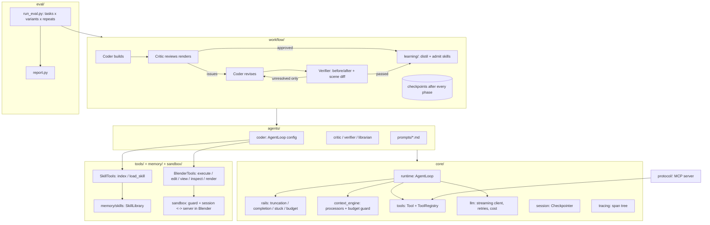

# BlendHarness

**一个可自我进化的 Blender 多 Agent harness：通过编写 Blender Python 代码，把自然语言描述变成可编辑的 3D 场景。底层是从零实现的 Agent harness。**

[English](README.md)


本项目不直接生成网格，具体分工如下：
- **Coder** Agent 在沙箱化的 headless Blender 里编写并执行 `bpy` 脚本；
- **Critic**（视觉评审）根据渲染图挑出问题；
- **Verifier** 对照修改前后的渲染图，以及场景结构的差异，逐条核实问题是否修好。

通过评审的作品，还可以被提炼成**可自我进化的技能库**，里面是验证过、可复用的建模函数。最终产物是一份普通的 Python 脚本，所以每个物体都可以继续编辑。

项目思路最初来自 [LL3M 论文](https://arxiv.org/abs/2508.08228)。本仓库**不包含任何 LL3M 代码**：harness、沙箱、Agent、记忆和评测都是从零编写，并根据实测数据重新设计的。

## 亮点

- **自研的 Agent harness**：基于工具调用的 Agent 循环，由模型决策、harness 执行。循环本身只保留机制；各种策略都放在可插拔的 **rail** 里，包括截断处理、由 harness 验证的完成检查、同一错误重复时停止、成本预算。循环在固定的事件点上，按优先级询问这些 rail。
- **进程级隔离的 Blender 沙箱 + 静态检查**：每个任务一个常驻的 headless Blender，每次执行前都恢复成空场景，看门狗负责处理卡死和崩溃。模型写的代码在运行前先用 `ast` 检查一遍，禁止访问文件系统、进程和网络。这套检查用 232 个历史脚本校准过，其中有一次真实运行里，Coder 翻遍主机磁盘去读我们自己的日志。
- **上下文引擎**：一条 processor 流水线，从完整历史生成模型实际看到的内容。过期的脚本换成占位符，当前脚本固定在末尾，最后由预算守卫兜底。token 估算用自己的 trace 校准过：代码为主的上下文约 2.3 个字符折合 1 个 token，而不是常说的 4 个。
- **按权限分级的工具**：只有一个 `ToolRegistry`（read / write / execute 三档）。它同时供 Agent 循环和 **MCP Server** 使用，所以 Claude Desktop、Claude Code、Cursor 也能直接使用同一个沙箱。
- **断点续跑**：每个阶段结束都是一个安全点，以原子写入的方式存成 JSON。中断的建模可以接着跑，也可以换一套配置，从任意阶段分叉出一次新的运行。
- **两级视觉评审**：Critic 回答开放式问题（"有什么问题？"），Verifier 回答封闭式问题（"每个问题修好了吗？有没有改出新问题？"）。能用程序判断的，总是先用程序判断，然后才调用视觉模型。
- **可自我进化的技能库**：Librarian 从通过评审的作品里提炼可复用的函数。每个候选都要通过四道准入关卡（静态检查、去重、沙箱运行、结构检查加视觉检查），没通过的还有一次修复机会。提示词里只列出技能目录，用到时再按需加载。
- **追踪与评测**：每次 LLM 调用、工具调用和 Agent 运行都是一个 span，记录 token、成本和耗时。评测运行器支持断点续跑和单题崩溃隔离，不同版本交错执行，保证对比公平。
- **测试**：180 个测试，约 6 秒跑完。包括用假 LLM 和假 Blender 跑的单元测试、分层规则测试，以及在真实 Blender 上跑的集成测试。

## 架构



| 层 | 目录（`blendharness/`） | 职责 |
|---|---|---|
| 核心 | `core/` | 通用机制，不涉及任何 Blender 相关内容：`runtime`（Agent 循环）、`rails`、`context_engine`、`tools`（Tool、ToolRegistry）、`llm`、`session`（断点存档）、`tracing` |
| 沙箱 | `sandbox/` | `server.py` 运行在 Blender **内部**；`session.py` 驱动 Blender 并带看门狗；`guard.py` 做静态检查 |
| 记忆 | `memory/skills/` | `SkillLibrary`：每个技能一个文件夹（`SKILL.md` + `skill.py` + `stats.json`） |
| 工具 | `tools/` | `BlenderTools`（脚本状态，以及执行、编辑、查看、检查）、`scene.py`、`render.py`、`SkillTools` |
| Agent | `agents/` | 各 Agent 的配置：Coder（提示词 + 工具 + 上下文流水线 + 完成检查）、Critic、Verifier、Librarian；提示词放在 `prompts/*.md` |
| 编排 | `workflow/` | `run_build`：把建模、评审、修改、核实、提炼技能拆成带断点的阶段；`learning/` 放准入关卡和学习流程 |
| 协议 | `protocol/` | `blendharness-mcp`：把工具以 MCP Server 的形式开放出去 |

依赖只能单向：`core` ← `sandbox`、`memory` ← `tools` ← `agents` ← `workflow`；`protocol` 只依赖 `tools`。这条规则由 `tests/unit/test_architecture.py` 强制检查。详见 [`docs/architecture.md`](docs/architecture.md)。

**设计原则：**
- **机制与策略分离**：循环负责运行，rail 负责决策。
- **框架与配置分离**：只有一个通用的循环，每个 Agent 只是一份配置。
- **依赖倒置**：`BlenderTools` 只认识一个通用的 `preamble_provider` 挂钩，并不知道"技能"的存在。
- **由便宜到贵**：先做确定性的程序检查，再调用视觉模型。
- **故障安全**：评审和关卡拿不准时，一律判为不通过。

## 实验结果

所有数字都来自评测框架，测量于 2026 年 10 月的重构之前（commit `e46c5ab`）。重构保持了行为不变：原有测试一行未改且全部通过，提示词逐字一致，上下文策略也通过了差分测试。Coder 使用 Claude Sonnet，`reasoning_effort` 设为 `low`；Critic、Verifier 和技能评审使用 Claude Haiku。**每个条件只跑了 2 次**，较小的差异应视为随机波动。

| 实验 | 设置 | 结论 |
|---|---|---|
| `m3_vs_baseline` | 6 道题 × 2 次：完整重写 + 完整历史 vs. 局部编辑 + 历史压缩（v1） | 通过率相同（75%），每题成本降低 13%。但**修改轮反而更贵**（中位数 $0.446 vs $0.274）：压缩把正在编辑的脚本也藏起来了，模型重新读了 17 次；逐处编辑又带来了大量往返。之前单次运行得到的"降低 73%"没有复现。 |
| `m3v2` | 当前脚本常驻上下文 + 批量、全有或全无的编辑；3 道最难的题 × 2 次 | **6/6 通过**（基线 4/6），**每题成本降低 14%**，重新读取脚本 0 次。修改轮的输出 token 里，85%–92% 是看不见的思考，所以剩下的降本空间在思考控制，而不在上下文。 |
| `skills_lc` | 学习曲线：先在 5 道训练题上积累技能，再在 5 道有共用部件、但从没见过的测试题上，对比有和没有技能库两种条件 | 技能库积累到 10 个验证过的技能（修复轮救回了 8 个被拒的候选）。测试通过率：有技能库 6/10，没有技能库 8/10，**但 4 次失败都和技能无关**。**只有 4/10 次运行真正用上了技能**；用上技能的村庄任务 2/2 在第一轮就通过，成本降低 34%。瓶颈在于技能粒度太粗，提炼出的是整件家具，换个题目就用不上。 |

`skills_lc` 训练出的技能库在 [`skills/`](skills/) 目录里：


下面这些经验影响了设计，每一条都是通过追踪记录或评测发现的：
- **"能运行"不等于"是对的"**：首批提炼的 9 个技能里，有 3 个能正常执行，但其实是坏的（部件陷进地下或互相重叠）。免费的结构检查（落地 + 连通）能把它们拦下。
- **推理模型容易想太多**：默认设置下，模型在第一次调用工具前就花掉了 1.2 万到 3.2 万个思考 token；设为 `reasoning_effort: low` 后降到约 1,700 个。但同一个参数在 Haiku 上反而会**打开**思考，所以思考强度要按 Agent 分别配置。
- **中转站会静默截断流式输出**：有的回复只传回两个 token 就结束了，而且不报错。现在，没有 `finish_reason` 的流一律视为不完整，并自动重试。

## 快速开始

**环境要求：** macOS 或 Linux；[Blender 4.4.3](https://download.blender.org/release/Blender4.4/)；Python 3.12；兼容 OpenAI 协议的 API（实验中，Claude 通过中转站调用，另外也用到了 DeepSeek API）。

```bash
conda create -n blender-agent python=3.12 -y && conda activate blender-agent
pip install -e ".[dev,mcp]"    # 以可编辑模式安装 blendharness 包，以及 pytest 和 MCP SDK
cp .env.example .env        # 填写 OPENAI_BASE_URL / OPENAI_API_KEY（如果用 DeepSeek，再填 DEEPSEEK_*）
# Blender 路径默认是 /Applications/Blender.app/Contents/MacOS/Blender，可以用 BLENDER_PATH 覆盖
```

模型按名字前缀路由：`deepseek` 开头的模型使用 `DEEPSEEK_*`，其余都使用 `OPENAI_*`。请在 `config/prices.json` 里填写价格（每百万 token 的美元价格），这样成本和预算才能计算。

```bash
python scripts/smoke_llm.py claude-haiku-4-5     # 测试 API、工具调用和错误记录
python scripts/smoke_blender.py                  # 测试沙箱：场景重置、报错、看门狗、渲染

# 生成一个场景（Coder → Critic → 修改 → Verifier）
python scripts/run_build.py "Create a wooden dining chair with four legs and a slatted backrest" \
    --model claude-sonnet-4-6 --critic-model claude-haiku-4-5 --rounds 2 --effort low

# 中断后接着跑；或者从某个阶段分叉，换一套配置
python scripts/run_build.py --resume runs/<run_id>
python scripts/run_build.py --fork-from runs/<run_id> --at round0 --rounds 3

# 运行评测
python eval/run_eval.py --exp my_exp --variants baseline m3 --repeats 2 --workers 3
python eval/report.py --exp my_exp

# 测试（不调用 API；没装 Blender 时会跳过集成测试）
python -m pytest

# 把工具开放给 MCP 客户端（Claude Desktop、Claude Code、Cursor），见 docs/mcp.md
blendharness-mcp
```

每次运行会生成 `runs/<run_id>/` 目录，包括：
- `trace.jsonl`：调用记录摘要
- `payloads/`：发给模型的完整请求和模型的完整回复
- `renders/`：渲染图
- `checkpoints/`：每个阶段完成后存一份 JSON
- `final_script.py`：可以独立运行的最终脚本（包含用到的技能代码）
- `result.json`：运行结果
- `blender.log`：Blender 日志

## 目录结构

```
blendharness/
  core/        runtime/  rails/  context_engine/  tools/  llm/  session/  tracing/
  sandbox/     server.py  session.py  guard.py
  memory/      skills/library.py
  tools/       blender_tools.py  scene.py  render.py  skill_tools.py
  agents/      coder.py  critic.py  verifier.py  librarian.py  prompts/*.md
  workflow/    build.py  state.py  learning/admission.py  learning/learn.py
  protocol/    mcp_server.py
eval/          run_eval.py  report.py  tasks.json  tasks_skills.json
scripts/       run_build.py  relearn.py  recost.py  smoke_*.py  demo_loop.py  run_coder.py
tests/         unit/  integration/  fakes.py
skills/        学到的技能库
config/        prices.json
docs/          architecture.md  mcp.md  roadmap.md  图片
```

## 局限与后续计划

- **样本量小**：每个条件只重复了 2 次，而相同条件下两次运行的结果差异也很大。关键实验应该重复 3–5 次。
- **技能采用率低**：技能粒度太粗，难以迁移到新题目。下一步：提炼可组合的零件（一组腿、一摞抽屉、把手、屋顶），并由 harness 针对每个请求检索、推荐最相关的几个技能。
- **成本**：修改轮的大部分成本来自看不见的思考。下一步：按阶段做模型路由（修改轮使用更便宜的模型或更低的思考强度），以及"先便宜、失败再升级"的级联策略，并与"全部用便宜模型"和"全部用强模型"两种方案对比。
- **沙箱范围**：进程隔离加静态检查，能拦住现实中常见的情况；但静态检查可以被混淆代码绕过。如果要作为公开服务，需要换成容器隔离。
- **渲染**：颜色略微偏淡；液面上的高光可能让视觉模型误认出不存在的物体。

更多设计说明见 [`docs/roadmap.md`](docs/roadmap.md)。
