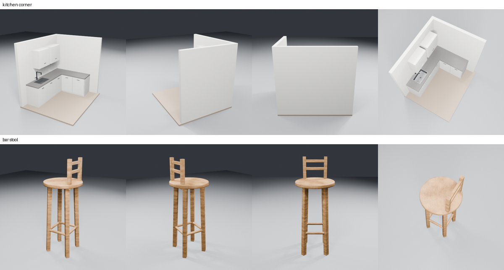
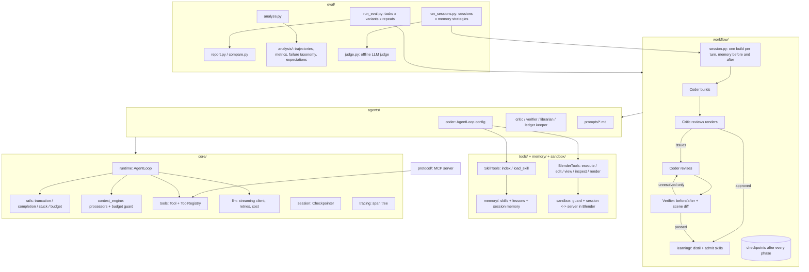
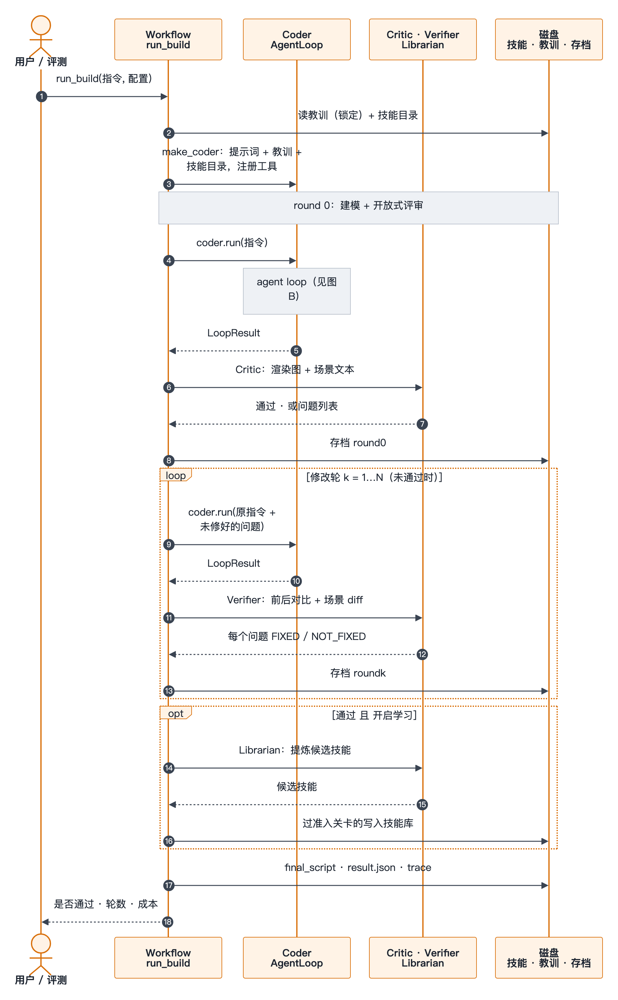
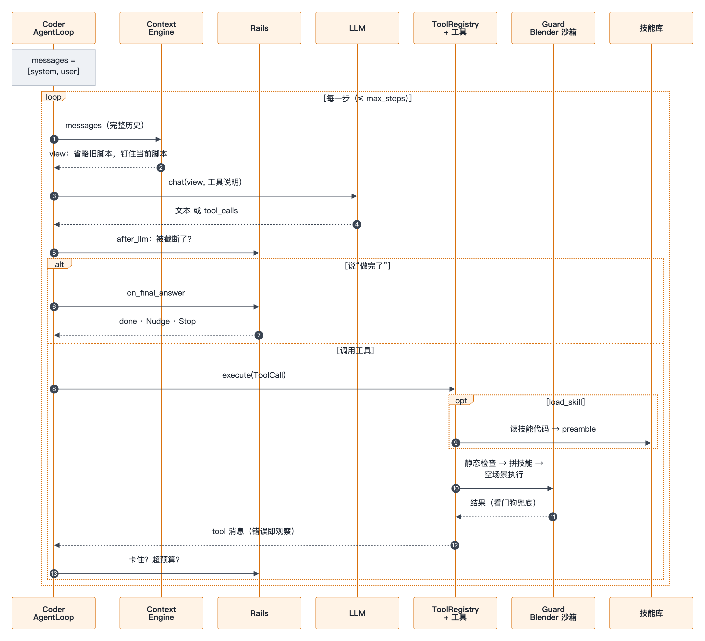
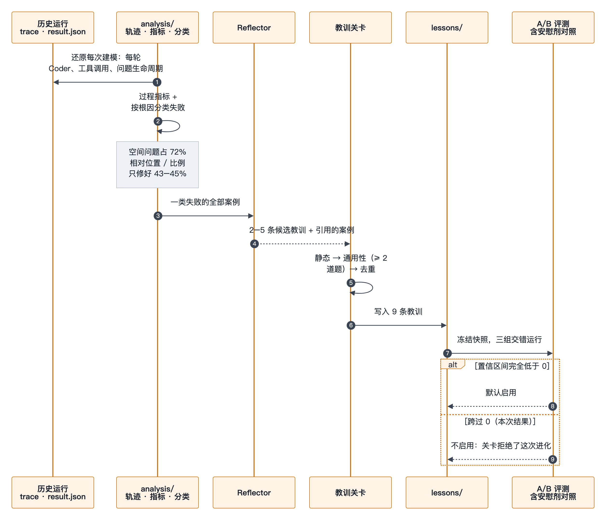
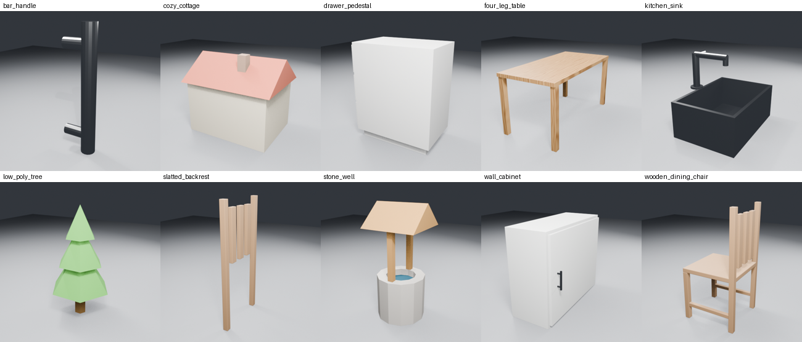

# BlendHarness

**一个可自我进化的 Blender 多 Agent harness：通过编写 Blender Python 代码，把自然语言描述变成可编辑的 3D 场景。底层是从零实现的 Agent harness。**

[English](README.md)



本项目不直接生成网格，具体分工如下：
- **Coder** Agent 在沙箱化的 headless Blender 里编写并执行 `bpy` 脚本；
- **Critic**（视觉评审）根据渲染图挑出问题；
- **Verifier** 对照修改前后的渲染图，以及场景结构的差异，逐条核实问题是否修好。

通过评审的作品，还可以被提炼成**可自我进化的技能库**，里面是验证过、可复用的建模函数。最终产物是一份普通的 Python 脚本，所以每个物体都可以继续编辑。场景还支持**多轮编辑**：用户每提一个需求，就在上一轮的脚本上修改，配有分层的会话记忆和程序化的回归检查。

项目思路最初来自 [LL3M 论文](https://arxiv.org/abs/2508.08228)。本仓库**不包含任何 LL3M 代码**：harness、沙箱、Agent、记忆和评测都是从零编写，并根据实测数据重新设计的。

## 亮点

- **自研的 Agent harness**：基于工具调用的 Agent 循环，由模型决策、harness 执行。循环本身只保留机制；各种策略都放在可插拔的 **rail** 里，包括截断处理、由 harness 验证的完成检查、同一错误重复时停止、成本预算。循环在固定的事件点上，按优先级询问这些 rail。
- **进程级隔离的 Blender 沙箱 + 静态检查**：每个任务一个常驻的 headless Blender，每次执行前都恢复成空场景，看门狗负责处理卡死和崩溃。模型写的代码在运行前先用 `ast` 检查一遍，禁止访问文件系统、进程和网络。这套检查用 232 个历史脚本校准过，其中有一次真实运行里，Coder 翻遍主机磁盘去读我们自己的日志。
- **上下文引擎**：一条 processor 流水线，从完整历史生成模型实际看到的内容。过期的脚本换成占位符，当前脚本固定在末尾，最后由预算守卫兜底。token 估算用自己的 trace 校准过：代码为主的上下文约 2.3 个字符折合 1 个 token，而不是常说的 4 个。
- **按权限分级的工具**：只有一个 `ToolRegistry`（read / write / execute 三档）。它同时供 Agent 循环和 **MCP Server** 使用，所以 Claude Desktop、Claude Code、Cursor 也能直接使用同一个沙箱。
- **断点续跑**：每个阶段结束都是一个安全点，以原子写入的方式存成 JSON。中断的建模可以接着跑，也可以换一套配置，从任意阶段分叉出一次新的运行。
- **两级视觉评审**：Critic 回答开放式问题（"有什么问题？"），Verifier 回答封闭式问题（"每个问题修好了吗？有没有改出新问题？"）。能用程序判断的，总是先用程序判断，然后才调用视觉模型。
- **可自我进化的技能库**：Librarian 从通过评审的作品里提炼可复用的函数。每个候选都要通过四道准入关卡（静态检查、去重、沙箱运行、结构检查加视觉检查），没通过的还有一次修复机会。提示词里只列出技能目录，用到时再按需加载。
- **追踪与评测**：每次 LLM 调用、工具调用和 Agent 运行都是一个 span，记录 token、成本和耗时。评测运行器支持断点续跑和单题崩溃隔离，不同版本交错执行，保证对比公平。
- **基于轨迹的评测 + 由评测把关的自进化**：把每次历史建模从 trace 还原出来，算出过程指标，并按根因对失败分类。Reflector 把失败案例提炼成经验教训（语义记忆）。但教训只有在没见过的题目上、经过预先注册的 A/B 测试（带安慰剂对照）证明有效，才会被采用。目前还没有通过，所以评测关卡把它挡在了外面（见实验结果）。
- **多轮场景编辑**：会话每轮只交给系统一句需求；每一轮都是一次完整的建模，从上一轮的脚本开始改，从第 2 轮起 Coder 必须声明改了什么。三种记忆策略从同一个起点分叉，可以公平对比：
  - M0：完整的历史需求原文；
  - M2 结构化记忆：只追加的需求账本（由 LLM 维护，但必须通过程序检查），加上由程序从真实场景快照生成的场景登记表和轮次日志，存在 SQLite 里；
  - M3 检索：在 M2 的基础上，用 BM25 + 本地向量 + RRF 检索脚本片段，并顺着变量的定义-使用关系补全。
- **多轮编辑的两层评测**：
  - 基于场景快照的程序检查：要求的改动做到了没有、允许范围以外的物体有没有被改动、早期的要求是否还成立；
  - 离线的 LLM 裁判，用和 Coder 不同家族的模型：带依赖的原子细则问题、带锚点的打分、交换左右的两两比较 + Bradley–Terry Elo。
  - 先跑试点校准检查器，再看结论。
- **测试**：286 个测试，约 8 秒跑完。包括用假 LLM 和假 Blender 跑的单元测试、分层规则测试，以及在真实 Blender 上跑的集成测试。

## 架构



| 层 | 目录（`blendharness/`） | 职责 |
|---|---|---|
| 核心 | `core/` | 通用机制，不涉及任何 Blender 相关内容：`runtime`（Agent 循环）、`rails`、`context_engine`、`tools`（Tool、ToolRegistry）、`llm`、`session`（断点存档）、`tracing` |
| 沙箱 | `sandbox/` | `server.py` 运行在 Blender **内部**；`session.py` 驱动 Blender 并带看门狗；`guard.py` 做静态检查 |
| 记忆 | `memory/` | `skills/`：`SkillLibrary`，每个技能一个文件夹（`SKILL.md` + `skill.py` + `stats.json`）；`lessons/`：`LessonLibrary`，从失败中学到的规则；`session/`：多轮会话的记忆，存在 SQLite 里（需求账本、场景登记表、轮次日志、向量缓存），以及脚本切段和检索 |
| 分析 | `analysis/` | 从 `trace.jsonl` 和 `result.json` 还原每次建模（Coder 每一轮的运行、工具调用、每个问题跨轮次的生命周期），计算过程指标，按根因对失败分类；结构检查和关系检查；`expectations.py`：基于场景快照的多轮程序检查和回归判断 |
| 工具 | `tools/` | `BlenderTools`（脚本状态，以及执行、编辑、查看、检查）、`scene.py`、`render.py`、`SkillTools` |
| Agent | `agents/` | 各 Agent 的配置：Coder（提示词 + 工具 + 上下文流水线 + 完成检查）、Critic、Verifier、Librarian、Reflector、账本管理员；提示词放在 `prompts/*.md` |
| 编排 | `workflow/` | `run_build`：把建模、评审、修改、核实、提炼技能拆成带断点的阶段；`session.py`：多轮会话（记忆策略、每轮存档、续跑和分叉）；`learning/` 放技能的准入关卡和学习流程，以及教训的准入关卡 |
| 协议 | `protocol/` | `blendharness-mcp`：把工具以 MCP Server 的形式开放出去 |

依赖只能单向：`core` ← `sandbox`、`memory` ← `tools` ← `agents` ← `workflow`；`analysis` 只依赖 `core`；`protocol` 只依赖 `tools`。这条规则由 `tests/unit/test_architecture.py` 强制检查。详见 [`docs/architecture.md`](docs/architecture.md)。

**设计原则：**
- **机制与策略分离**：循环负责运行，rail 负责决策。
- **框架与配置分离**：只有一个通用的循环，每个 Agent 只是一份配置。
- **依赖倒置**：`BlenderTools` 只认识一个通用的 `preamble_provider` 挂钩，并不知道"技能"的存在。
- **由便宜到贵**：先做确定性的程序检查，再调用视觉模型。
- **故障安全**：评审和关卡拿不准时，一律判为不通过。

## 一次建模是怎么跑起来的

整体是两层嵌套的循环：
- **外层是 workflow**，流程由代码写死：建模 → 评审 → 修改 → 核实 → 学习，每个阶段结束都存一次档；
- **内层是 agent loop**，每一步做什么由模型自己决定。

只有 Coder 跑在 agent loop 里；Critic、Verifier、Librarian 都只是一次 LLM 调用。

**图 A · Workflow（外层，由代码决定流程）**



**图 B · Agent loop（内层，由模型决定每一步）**：每一次 `coder.run(...)` 内部发生的事



**图 C · 从失败中学习教训（离线进行，由评测把关）**



图的源码放在 [`docs/diagrams/`](docs/diagrams/)（Mermaid 格式）。修改后运行 `python scripts/render_diagrams.py`，就会用 headless Chrome 重新生成图片。[`docs/blendharness_flow.html`](docs/blendharness_flow.html) 把四张生命周期图放在了一个页面里（一次建模、学习教训、多轮会话的一轮、多轮实验），下载后用浏览器打开即可。

## 多轮场景编辑

真实用户很少一次就把整个场景描述完，而是不断提出修改。这带来了单次建模没有的两个问题：
- **记忆**：早期的要求不能忘，"那个桶"要能对应到正确的物体；
- **回归**：改一处不能把别处改坏。回归可以用程序检查。

设计、代码导读和结果见 [`docs/multiturn_design.md`](docs/multiturn_design.md)。

一轮是怎么运行的（`workflow/session.py`）：
1. 上一轮结束后，下一句需求才交给系统；系统看不到后面的轮次，也看不到评测里写好的期望改动。
2. 从上一轮的副本恢复记忆，所以重跑中断的一轮，也不会把同一条需求写两次。
3. （M2 / M3）账本管理员（一次 Haiku 调用）提议新增、取代和指代消解的需求。程序检查这份提议：只能取代有效的需求、必须给出理由、物体名必须存在。不合格就带着问题重试一次，还不合格就把需求原文直接加进账本。写入账本的是程序，不是模型。
4. 按记忆策略拼出任务文字：M0 列出早期需求原文；M2 给出有效的账本、由程序生成的场景登记表和每轮一行的日志；M3 还会把钉在末尾的整份脚本，换成大纲加上检索出的片段。
5. 用普通的 `run_build` 在上一轮的脚本上修改，Critic、修改轮和 Verifier 都和单次建模一样；从第 2 轮起，Coder 必须调用 `declare_changes`。
6. 程序算出非请求改动（快照前后的变化减去 Coder 声明的改动）和这次实际改到的脚本片段（检索的标准答案），从新快照重建登记表，再把会话状态和记忆一起存档。

评测：会话的每一轮都写好了：
- `expect`：对场景快照的检查；
- `touches`：这一轮允许改动的物体，其他物体变了就算回归；
- `persist`：之后要一直成立的要求；
- 给裁判用的细则清单。

`eval/run_sessions.py` 每个会话的第 1 轮只跑一次，各组都从它分叉，并行运行；`eval/judge.py` 负责 LLM 裁判；`eval/replay_retrieval.py` 在已有的会话记录上离线重放检索，不调用模型。

## 实验结果

所有数字都来自评测框架。第一张表测量于 2026 年 10 月的重构之前（commit `6d3ed0c`），后面各节分别注明了自己的设置。重构保持了行为不变：原有测试一行未改且全部通过，提示词逐字一致，上下文策略也通过了差分测试。Coder 使用 Claude Sonnet，`reasoning_effort` 设为 `low`；Critic、Verifier 和技能评审使用 Claude Haiku。**每个条件只跑了 2 次**，较小的差异应视为随机波动。

| 实验 | 设置 | 结论 |
|---|---|---|
| `m3_vs_baseline` | 6 道题 × 2 次：完整重写 + 完整历史 vs. 局部编辑 + 历史压缩（v1） | 通过率相同（75%），每题成本降低 13%。但**修改轮反而更贵**（中位数 $0.446 vs $0.274）：压缩把正在编辑的脚本也藏起来了，模型重新读了 17 次；逐处编辑又带来了大量往返。之前单次运行得到的"降低 73%"没有复现。 |
| `m3v2` | 当前脚本常驻上下文 + 批量、全有或全无的编辑；3 道最难的题 × 2 次 | **6/6 通过**（基线 4/6），**每题成本降低 14%**，重新读取脚本 0 次。修改轮的输出 token 里，85%–92% 是看不见的思考，所以剩下的降本空间在思考控制，而不在上下文。 |
| `skills_lc` | 学习曲线：先在 5 道训练题上积累技能，再在 5 道有共用部件、但从没见过的测试题上，对比有和没有技能库两种条件 | 技能库积累到 10 个验证过的技能（修复轮救回了 8 个被拒的候选；其中结构关卡的 5 次拒绝后来查明是场景检查器的 bug 造成的误判，见下）。测试通过率：有技能库 6/10，没有技能库 8/10，**但 4 次失败都和技能无关**。**只有 4/10 次运行真正用上了技能**；用上技能的村庄任务 2/2 在第一轮就通过，成本降低 34%。瓶颈在于技能粒度太粗，提炼出的是整件家具，换个题目就用不上。 |

### 从失败中自进化，由评测把关（2026 年 10 月）

| 步骤 | 设置 | 结论 |
|---|---|---|
| 轨迹分析 | 69 次历史建模，79 个 Critic 提出的问题按根因分类 | 空间问题占全部问题的 **72%**。接触类问题（悬空、穿插）通过"Critic → Coder → Verifier"闭环能修好 73–85%；**关系类问题**（相对位置、比例）只能修好 **43–45%**，而且是失败建模里遗留问题最多的一类。代码报错不是瓶颈：执行失败率 9%，其中 89% 在同一轮里就自己修好了。 |
| 经验教训 | Reflector 读 23 个关系类案例（问题、Critic 建议的修法、Verifier 的判定理由） | 提炼出 9 条教训，例如"部件的位置从它所依附部件的包围盒推出来"、"修位置要改 location 和 rotation，不要只改尺寸"。准入关卡：通用性（引用的案例必须来自至少 2 道题，由我们自己核对）、去重。 |
| `lessons_ab` | 8 道新题（避开训练题里的物体），有教训 vs 无教训，各 2 次 | 预先注册的主要指标（第一轮的关系类问题数）没有得出结论，原因是**地板效应**：两组各 16 次建模，这类问题一共只有 2 个对 1 个。探索性发现：成本 −24%，Coder 步数 −20%。 |
| `lessons_confirm` | 预先注册的确认实验：有教训 / 无教训 / **安慰剂**（同样长度的通用建议），各 2 次 | **成本下降没有复现**（有教训 − 无教训：−$0.007，95% 置信区间 [−0.12, +0.11]）。对照组的成本在两个晚上之间差了 34%，比要测的效果还大。因此教训**默认不启用**：评测关卡拒绝了这一步进化。 |

### 修复后的新基线（2026 年 10 月）

修好场景检查器的 bug（见下）、并让 `inspect_scene` 打印包围盒而不是物体原点之后，用 Sonnet（每题 2 次）和 DeepSeek-v4-pro（每题 1 次）交错重跑了 26 道题，共 78 次建模，花费 $21.2。
- Sonnet 最终通过率 92–100%，第一轮每次建模只有约 0.2–0.3 个空间问题；
- DeepSeek 的问题多 2–4 倍，主要是材质和形状，成本是 Sonnet 的 40–70%。

所以专门做一个"空间修正模型"，对这条流水线的提升空间很小。下一步因此转向多轮编辑，以及后训练一个小模型。

### 多轮编辑试点（2026 年 10 月）

3 个会话（村庄、卧室、街角，各 6 轮）× M0 两次、M2 两次、M3 一次，共 75 个编辑轮，花费 $48.6。

这是一次**探索性试点**：程序检查是用试点自己的数据校准的。有 5 项检查在所有组都失败，查下来是检查本身写错了，比如 `frame` 把床架 `Bed_Frame` 也匹配进去了；每处修改都记录在会话文件里。所以下面的数字应该理解为"观察到的现象 + 查明的原因"，而不是确认过的效果。

| 指标 | M0 完整历史 | M2 结构化记忆 | M3 + 检索 |
|---|---|---|---|
| 单轮完成率（全部检查通过） | 93% | 93% | 73% |
| 有回归的轮次 | 1/30 | 0/30 | 1/15（133 个物体） |
| 需求保持率 | 100% | 100% | 100% |
| 每轮成本 | $0.44 | $0.49 | $0.74 |

- **在短会话里，结构化记忆没有显示出收益**：6 句一句话的需求，原文照抄也不长；所有策略的需求保持率都是 100%，指代也都很直白。两两比较的 LLM 裁判（gpt-5.5，交换左右）也给出了一样的结论：6 个维度里有 5 个以平局为主。组件本身是可用的：45 次账本更新 0 次走兜底，抽查的取代全部正确。
- **在这个脚本规模下，检索视图得不偿失**：脚本约 5k token，低于设计里切换到大纲的 1.2 万 token 阈值，这次是为了测试强制使用的。Coder 每轮要读 3.8 次代码，还有两次凭记忆重写了整个场景，其中一次造成 133 个回归物体。
- **检索本身没问题，但混合检索没有带来提升**：在 M2 的轮次上离线重放，recall@3 向量检索 0.76、BM25 0.62、RRF 混合 0.60。
- **在所有组都失败的检查，多半是检查本身错了**：正式实验之前先跑试点，是值得的。

几点收获：
- 探索性的好结果，必须经过预先注册的确认实验和安慰剂对照。这是项目里第二次出现"单次实验的效果没复现"。
- 测试题里必须真的会出现要针对的失败类型。关系类错误集中在多物体场景里，这也是单独做一个空间布局项目的理由。
- 中转站本身也是实验变量：它会悄悄拦截某些提示词，而且拦截规则会随时间变化。

### 技能库

`skills_lc` 训练出的技能库在 [`skills/`](skills/) 目录里：



下面这些经验影响了设计，每一条都是通过追踪记录或评测发现的：
- **检查器本身也要被检查**：结构关卡（落地 + 连通）曾以"陷进地下"为由拒绝了 5 个候选技能。后来对全部 144 次建模做的纯几何审计发现，这些都是误判：脚本设置 `obj.location` / `obj.scale` 之后没有触发依赖图更新，`matrix_world` 还是旧的，场景检查器算出的世界坐标包围盒就停在原点、也没有缩放（35% 的建模里至少有一个这样的物体）。现在检查器会先刷新视图层，这 5 个候选全部通过。上面的 A/B 结论不受影响，因为每组对比的两边都带着同一个 bug。
- **推理模型容易想太多**：默认设置下，模型在第一次调用工具前就花掉了 1.2 万到 3.2 万个思考 token；设为 `reasoning_effort: low` 后降到约 1,700 个。但同一个参数在 Haiku 上反而会**打开**思考，所以思考强度要按 Agent 分别配置。
- **中转站会静默截断流式输出**：有的回复只传回两个 token 就结束了，而且不报错。现在，没有 `finish_reason` 的流一律视为不完整，并自动重试。

## 快速开始

**环境要求：** macOS 或 Linux；[Blender 4.4.3](https://download.blender.org/release/Blender4.4/)；Python 3.12；兼容 OpenAI 协议的 API（实验中，Claude 通过中转站调用，另外也用到了 DeepSeek API）。

```bash
conda create -n blender-agent python=3.12 -y && conda activate blender-agent
pip install -e ".[dev,mcp]"    # 以可编辑模式安装 blendharness 包，以及 pytest 和 MCP SDK
cp .env.example .env        # 填写 OPENAI_BASE_URL / OPENAI_API_KEY（如果用 DeepSeek，再填 DEEPSEEK_*）
# Blender 路径默认是 /Applications/Blender.app/Contents/MacOS/Blender，可以用 BLENDER_PATH 覆盖
```

模型按名字前缀路由：`deepseek` 开头的使用 `DEEPSEEK_*`；`gpt` / `gemini` 开头的使用 `JUDGE_*`（离线裁判，没配置时退回 `OPENAI_*`）；其余都使用 `OPENAI_*`。检索（M3）需要 `pip install -e ".[retrieval]"`，本地 embedding 模型会在第一次使用时下载到 `models/fastembed/`。请在 `config/prices.json` 里填写价格（每百万 token 的美元价格），这样成本和预算才能计算。

```bash
python scripts/smoke_llm.py claude-haiku-4-5     # 测试 API、工具调用和错误记录
python scripts/smoke_blender.py                  # 测试沙箱：场景重置、报错、看门狗、渲染

# 生成一个场景（Coder → Critic → 修改 → Verifier）
python scripts/run_build.py "Create a wooden dining chair with four legs and a slatted backrest" \
    --model claude-sonnet-4-6 --critic-model claude-haiku-4-5 --rounds 2 --effort low

# 中断后接着跑；或者从某个阶段分叉，换一套配置
python scripts/run_build.py --resume runs/<run_id>
python scripts/run_build.py --fork-from runs/<run_id> --at round0 --rounds 3

# 运行评测
python eval/run_eval.py --exp my_exp --variants baseline m3 --repeats 2 --workers 3
python eval/report.py --exp my_exp
python eval/compare.py --exp my_exp --a baseline --b m3        # 配对 A/B 比较，带 bootstrap 置信区间

# 轨迹分析，以及从失败中自进化
python eval/analyze.py                  # 对全部历史建模算指标、做失败分类，结果写到 runs/analysis/
python scripts/reflect.py --dry-run     # 只列出 Reflector 会读的失败案例，不花钱
python scripts/reflect.py               # 把教训提炼到 lessons/（用 BuildConfig(lessons_dir=...) 启用）

# 多轮：交互式会话（--memory history / structured / retrieval；--resume 目录；--fork 目录 轮次）
python scripts/run_session.py --memory structured

# 多轮实验：每个会话的第 1 轮只跑一次，各组从它分叉，用程序检查打分
python eval/run_sessions.py --exp pilot --jobs 5
python eval/judge.py --exp pilot --model gpt-5.5 --modes rubric scores
python eval/judge.py --exp pilot --model gpt-5.5 --pairwise M2 M0
python eval/replay_retrieval.py runs/sessions/pilot/*/M2_r* --k 1 3 5

# 测试（不调用 API；没装 Blender 时会跳过集成测试）
python -m pytest

# 把工具开放给 MCP 客户端（Claude Desktop、Claude Code、Cursor），见 docs/mcp.md
blendharness-mcp
```

多轮实验写在 `runs/sessions/<实验名>/<会话>/` 下：`base/`（第 1 轮）、每组一个文件夹（`session.json`、`score.json`、`checkpoints/memory_tNN.db`、`turns/tNN/`，里面有场景快照和裁判结果），以及 `summary.md`。

每次运行会生成 `runs/<run_id>/` 目录，包括：
- `trace.jsonl`：调用记录摘要
- `payloads/`：发给模型的完整请求和模型的完整回复
- `renders/`：渲染图
- `checkpoints/`：每个阶段完成后存一份 JSON
- `final_script.py`：可以独立运行的最终脚本（包含用到的技能代码）
- `result.json`：运行结果
- `blender.log`：Blender 日志

## 目录结构

```
blendharness/
  core/        runtime/  rails/  context_engine/  tools/  llm/  session/  tracing/
  sandbox/     server.py  session.py  guard.py
  memory/      skills/library.py  lessons/library.py  session/{store,views,sections,retrieval}.py
  analysis/    trajectory.py  metrics.py  taxonomy.py  structure.py  relations.py  expectations.py
  tools/       blender_tools.py  scene.py  render.py  skill_tools.py
  agents/      coder.py  critic.py  verifier.py  librarian.py  reflector.py  ledger_keeper.py  prompts/*.md
  workflow/    build.py  state.py  session.py  learning/admission.py  learning/learn.py  learning/lessons.py
  protocol/    mcp_server.py
eval/          run_eval.py  report.py  compare.py  analyze.py  run_sessions.py  judge.py  judge_prompts/
               replay_retrieval.py  audit_structure.py  validate_relations.py  postfix_report.py
               tasks*.json  sessions_draft.json  placebo_lessons/
scripts/       run_build.py  run_session.py  walkthrough.py  render_diagrams.py  reflect.py  relearn.py  recost.py  smoke_*.py
tests/         unit/  integration/  fakes.py
skills/        学到的技能库
lessons/       学到的经验教训（默认不启用：没有通过 A/B 关卡）
config/        prices.json
docs/          architecture.md  multiturn_design.md  agentic_rl_plan.md  blendharness_flow.html  sessions_draft.md
               mcp.md  roadmap.md  diagrams/（Mermaid 源码 + PNG）  图片
```

## 局限与后续计划

- **样本量小**：每个条件只重复了 2 次，而相同条件下两次运行的结果差异也很大。关键实验应该重复 3–5 次。
- **教训的效果没有得到确认**：在单个物体的测试题上，无论是要针对的关系类错误，还是成本，都没有可测量的下降；而且这类错误在这些题上本来就很少出现。要做公平的测试，需要换成多物体场景，因为关系类错误主要出现在那里。
- **技能采用率低**：技能粒度太粗，难以迁移到新题目。下一步：提炼可组合的零件（一组腿、一摞抽屉、把手、屋顶），并由 harness 针对每个请求检索、推荐最相关的几个技能。
- **成本**：修改轮的大部分成本来自看不见的思考。下一步：按阶段做模型路由（修改轮使用更便宜的模型或更低的思考强度），以及"先便宜、失败再升级"的级联策略，并与"全部用便宜模型"和"全部用强模型"两种方案对比。
- **沙箱范围**：进程隔离加静态检查，能拦住现实中常见的情况；但静态检查可以被混淆代码绕过。如果要作为公开服务，需要换成容器隔离。
- **渲染**：颜色略微偏淡；液面上的高光可能让视觉模型误认出不存在的物体。
- **多轮试点**：只有 3 个短会话，M3 每个会话只跑了一次，检查器也是在同一批数据上校准的。要测出记忆的价值，需要更长的会话（12 轮以上），并且包含回指很早以前内容、推翻后又恢复的要求。M3 在公平测试之前还要先修：大纲视图下禁止整体重写、压缩过期的读取结果、只在超过长度阈值时才使用大纲。LLM 裁判和 Critic 都还需要和人工标注做校准。
- **按名字匹配的检查**：程序检查靠物体名匹配，名字起得奇怪就会误判，模型也可能通过改名来钻空子。
- **下一步：后训练**。计划把一个小模型（Qwen3-1.7B，先 SFT 再 GRPO）训练成场景编辑器，奖励完全由这些程序检查计算（能跑通、要求的改动做到了、回归要扣分）：见 [`docs/agentic_rl_plan.md`](docs/agentic_rl_plan.md)。

更多设计说明见 [`docs/roadmap.md`](docs/roadmap.md)。
